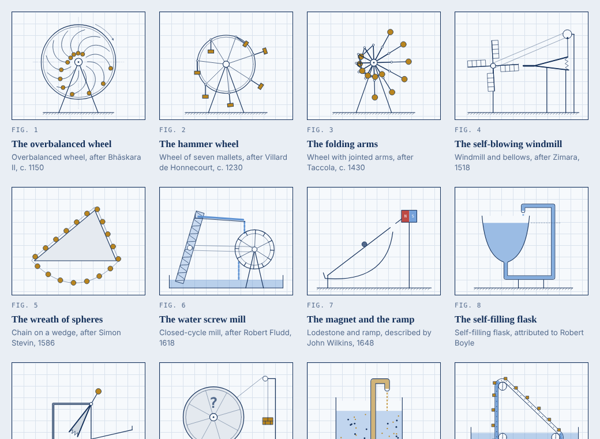

# Perpetuum Mobile

Fifty-six perpetual motion machines, drawn as animated blueprint sheets. Each one runs for ever, because the rule of physics it has to break is switched off. Switch the rule back on and the machine runs down, with a short explanation of why.



The site is plain HTML, CSS and JavaScript with no dependencies. Every page is a single self-contained file.

## Looking at it

Open `dist/index.html` in a browser. No server is needed.

- The gallery shows all 56 machines running as live thumbnails. One button enforces the rules on all of them at once.
- Each machine has its own page with the claim made for it, a switch for the rule it breaks, live readouts, and the reason it stops.
- The pages use the fonts Besley, IBM Plex Sans and IBM Plex Mono from Google Fonts. Without a network connection they fall back to system fonts and everything else still works.
- Light and dark themes follow the system setting. The machines pause when the system asks for reduced motion, until you press Run.

## Building

```
node build.js
```

This writes the gallery and the 56 machine pages to `dist/`. It needs Node.js and nothing else. It was built and tested with Node 22.

`dist/` is included in the repository, so you only need to build after changing something in `src/`.

## What is where

```
build.js                  assembles the pages
src/
  figs.js                 title, caption, claim and explanation for every machine, and their order
  helpers.js              drawing helpers shared by all machines
  machines/*.js           the machines: one function each
  runtime.js              mounts the machines on the page and runs the animation loop
  pm.css                  the stylesheet, light and dark
dist/
  index.html              the gallery
  <machine>.html          one page per machine
docs/gallery.png          the picture above
LICENSE                   GNU General Public License, version 3
```

## How a machine is written

A machine is a function that receives a canvas context and returns four methods. The canvas is always addressed as 420 by 340 units, whatever its real size.

```js
M.example = g => {
  const d = drive(1, 2.5);          // steady speed while helped along, runs down in about 2.5 s otherwise
  let angle = 0;
  return {
    step(dt, on) { d.step(dt, on); angle += d.v * dt; },   // on = the rule is in force
    draw(on) { /* draw one frame with g, using the colours in C */ },
    read(on) { return ['value 1', 'value 2', 'value 3']; }, // the three readouts
    stalled(on) { return d.stalled(); }                     // true shows the stamp
  };
};
```

To add a machine:

1. Write `M.yourname` in a file under `src/machines/`, starting with a comment line in the same form as the others (`/* ---------- title ---------- */`). The build uses that line to cut the file into machines.
2. Add an entry with the same name to `ALL` in `src/figs.js`, and put the name in `ORDER` where it should appear.
3. Run `node build.js`.

## How honest the animations are

With its rule suspended, each machine is simply driven: the wheel is turned at a steady speed, the pawl never slips, the pendulum loses nothing. That is the claim, shown as if it were true.

With the rule in force, several machines follow real mechanics. The overbalanced wheel computes the true torque from where its balls sit and comes to rest. The pendulum and the ball in the bowl are integrated with damping. The Brownian ratchet takes symmetric random kicks. The shielded magnet wheel rocks and settles facing its magnet. The rest decay at a rate chosen to be watchable.

The numbers in the readouts are illustrative, not measurements.

## Accuracy

Names, dates and mechanisms were checked against the sources below in October 2026. A few points rest on thin evidence, and the pages word them carefully:

- The self-filling flask is only attributed to Robert Boyle, and the two-liquid fountain only attributed to Johann Bernoulli.
- Zimara's windmill is dated 1518 on the strength of secondary sources.
- The mercury bellows was an anonymous French design. Denis Papin refuted it in 1685. He did not propose it.
- The explanation of why the two-liquid fountain fails, that flow through such a filter runs the other way as in osmosis, is the author's reasoning and was not taken from a source.

Sources:

- [History of perpetual motion machines (Wikipedia)](https://en.wikipedia.org/wiki/History_of_perpetual_motion_machines)
- [Donald Simanek, The Museum of Unworkable Devices](https://dsimanek.vialattea.net/museum/unwork.htm)
- [Museo Galileo, Taccola's wheel with articulated arms](https://mostre.museogalileo.it/motoperpetuo/en/before-leonardo/the-sienese-engineers/perpetual-wheel-with-articulated-arms.html)
- [Linda Hall Library, Simon Stevin](https://www.lindahall.org/about/news/scientist-of-the-day/simon-stevin/)
- [Britannica, closed-cycle water mill](https://britannica.com/technology/closed-cycle-water-mill)
- [Scientific American (1911), on Papin and the mercury bellows](https://www.scientificamerican.com/article/perpetual-motion-1911-11-18/)
- [Johann Bessler (Wikipedia)](https://en.wikipedia.org/wiki/Johann_Bessler)
- [Charles Redheffer (Wikipedia)](https://en.wikipedia.org/wiki/Charles_Redheffer)
- [John Keely (Wikipedia)](https://www.wikipedia.org/wiki/John_Keely)
- [Chemistry World, on Gamgee's zeromotor](https://www.chemistryworld.com/opinion/the-impossible-dream-of-perpetual-motion-machines/3004957.article)
- [Maxwell's demon (Wikipedia)](https://en.wikipedia.org/wiki/Maxwell%27s_demon)
- [Brownian ratchet (Wikipedia)](https://en.wikipedia.org/wiki/Brownian_ratchet)
- [Crookes radiometer (Wikipedia)](https://en.wikipedia.org/wiki/Crookes_radiometer)
- [Cox's timepiece (Wikipedia)](https://en.wikipedia.org/wiki/Cox%27s_timepiece)
- [Atmos clock (Wikipedia)](https://en.wikipedia.org/wiki/Atmos_clock)
- [Beverly Clock (Wikipedia)](https://en.wikipedia.org/wiki/Beverly_Clock)
- [Oxford Electric Bell (Wikipedia)](https://en.wikipedia.org/wiki/Oxford_Electric_Bell)
- [Drinking bird (Wikipedia)](https://en.wikipedia.org/wiki/Drinking_bird)
- [Automatic watch (Wikipedia)](https://en.wikipedia.org/wiki/Automatic_watch)

## The machines

### The first kind

Machines that give out more work than they take in. They break the first law of thermodynamics.

| Fig. | Machine | Drawn as | Page |
|---:|---|---|---|
| 1 | The overbalanced wheel | Overbalanced wheel, after Bhāskara II, c. 1150 | `wheel.html` |
| 2 | The hammer wheel | Wheel of seven mallets, after Villard de Honnecourt, c. 1230 | `villard.html` |
| 3 | The folding arms | Wheel with jointed arms, after Taccola, c. 1430 | `taccola.html` |
| 4 | The self-blowing windmill | Windmill and bellows, after Zimara, 1518 | `windmill.html` |
| 5 | The wreath of spheres | Chain on a wedge, after Simon Stevin, 1586 | `stevin.html` |
| 6 | The water screw mill | Closed-cycle mill, after Robert Fludd, 1618 | `fludd.html` |
| 7 | The magnet and the ramp | Lodestone and ramp, described by John Wilkins, 1648 | `wilkins.html` |
| 8 | The self-filling flask | Self-filling flask, attributed to Robert Boyle | `boyle.html` |
| 9 | The mercury bellows | Anonymous French design, refuted by Denis Papin, 1685 | `papin.html` |
| 10 | Bessler's wheel | Sealed wheel of Johann Bessler, called Orffyreus, 1717 | `bessler.html` |
| 11 | The two-liquid fountain | Filter and two liquids, attributed to Johann Bernoulli | `bernoulli.html` |
| 12 | The sponge band | Capillary engine, after Sir William Congreve, 1827 | `congreve.html` |
| 13 | The capillary fountain | Hair-thin tube standing in water | `capfount.html` |
| 14 | The fat-legged siphon | Siphon with one wide leg | `siphon.html` |
| 15 | The lopsided chain | Chain with a zigzag run | `chain.html` |
| 16 | The ball mill | Wheel fed by its own screw | `ballscrew.html` |
| 17 | The float belt | Float belt in a water column | `floats.html` |
| 18 | The opening floats | Wheel of bellows floats under water | `bfloat.html` |
| 19 | The drum in the tank wall | Drum half in water, half in air | `drum.html` |
| 20 | The shielded magnet wheel | Rotor of magnets with a shield | `shield.html` |
| 21 | The self-multiplying gears | Gear train closed on itself | `gears.html` |
| 22 | The motor and the dynamo | Motor and dynamo in a ring | `motor.html` |
| 23 | Water as fuel | Water split and burned in a ring | `waterfuel.html` |
| 24 | The magnet on a stick | Self-pulling cart | `cart.html` |

### The second kind

Machines that turn heat at a single temperature into work. They break the second law.

| Fig. | Machine | Drawn as | Page |
|---:|---|---|---|
| 25 | Maxwell's demon | Sorting demon, after James Clerk Maxwell, 1867 | `demon.html` |
| 26 | Loschmidt's column | Gas column under gravity, after Josef Loschmidt, 1876 | `loschmidt.html` |
| 27 | The zeromotor | Ammonia engine, after John Gamgee, 1881 | `zero.html` |
| 28 | The sea-heat steamer | Ship driven by the heat of the sea | `ship.html` |
| 29 | The one-way mirror | Two warm bodies and a one-way mirror | `mirror.html` |
| 30 | The trapdoor | Spring flap, after Smoluchowski, 1912 | `trapdoor.html` |
| 31 | The Brownian ratchet | Ratchet and pawl, after Smoluchowski, 1912 | `ratchet.html` |
| 32 | Szilard's engine | One-molecule engine, after Leo Szilard, 1929 | `szilard.html` |
| 33 | The noise rectifier | Resistor and diode, after Léon Brillouin, 1950 | `diode.html` |
| 34 | The two-metal ring | Ring of copper and bismuth | `thermoloop.html` |
| 35 | The radiometer in the dark | Light mill, after William Crookes, 1873 | `radiometer.html` |
| 36 | The heat pump loop | Heat pump driving its own engine | `heatpump.html` |

### The third kind

Machines that keep moving because nothing takes their energy away. Some loss always remains.

| Fig. | Machine | Drawn as | Page |
|---:|---|---|---|
| 37 | The frictionless pendulum | Pendulum under an evacuated bell jar | `pend.html` |
| 38 | The ball in the bowl | Ball rolling in a frictionless bowl | `bowl.html` |
| 39 | The weight on a spring | Weight on a perfect spring | `spring.html` |
| 40 | Newton's cradle | Cradle of perfectly elastic balls | `cradle.html` |
| 41 | The spinning top | Top on a perfect point | `top.html` |
| 42 | The tuning fork | Tuning fork in a vacuum | `fork.html` |
| 43 | The flywheel in a vacuum | Flywheel on magnetic bearings | `fly.html` |
| 44 | The satellite | Satellite in low orbit | `orbit.html` |
| 45 | The trapped flash | Flash of light between two mirrors | `light.html` |
| 46 | The ringing circuit | Coil and capacitor with no resistance | `lc.html` |
| 47 | The superconducting ring | Persistent current in a ring of lead | `ring.html` |
| 48 | The superfluid ring | Superfluid helium in a ring | `superfluid.html` |

### The impostors

Machines that did run, on energy nobody mentioned: two frauds, and six honest devices fed by their surroundings.

| Fig. | Machine | Drawn as | Page |
|---:|---|---|---|
| 49 | Redheffer's machine | Charles Redheffer, Philadelphia, 1812 | `redheffer.html` |
| 50 | The Keely motor | John Keely, Philadelphia, 1872 to 1898 | `keely.html` |
| 51 | Cox's timepiece | James Cox and John Joseph Merlin, 1760s | `cox.html` |
| 52 | The self-winding watch | Automatic watch, after Perrelet, c. 1777 | `watch.html` |
| 53 | The Oxford Electric Bell | Clarendon Laboratory, Oxford, ringing since 1840 | `oxford.html` |
| 54 | The Beverly Clock | Arthur Beverly, Dunedin, 1864 | `beverly.html` |
| 55 | The Atmos clock | Jean-Léon Reutter, 1928 | `atmos.html` |
| 56 | The drinking bird | Glass toy, patented by Miles V. Sullivan, 1946 | `bird.html` |

## Licence

Copyright (C) 2026 Jurgen Kobierczynski

This program is free software: you can redistribute it and/or modify it under the terms of the GNU General Public License as published by the Free Software Foundation, version 3.

This program is distributed in the hope that it will be useful, but WITHOUT ANY WARRANTY; without even the implied warranty of MERCHANTABILITY or FITNESS FOR A PARTICULAR PURPOSE. See the GNU General Public License for more details.

The full text is in [LICENSE](LICENSE). The SPDX identifier is `GPL-3.0-only`.

The fonts are loaded from Google Fonts at view time and are not part of this repository. They carry their own licence, the SIL Open Font License.

## Attribution

Made with Claude Opus 5.5 Medium, an AI model by Anthropic, which wrote the code, the drawings and the text at Jurgen Kobierczynski's direction.
